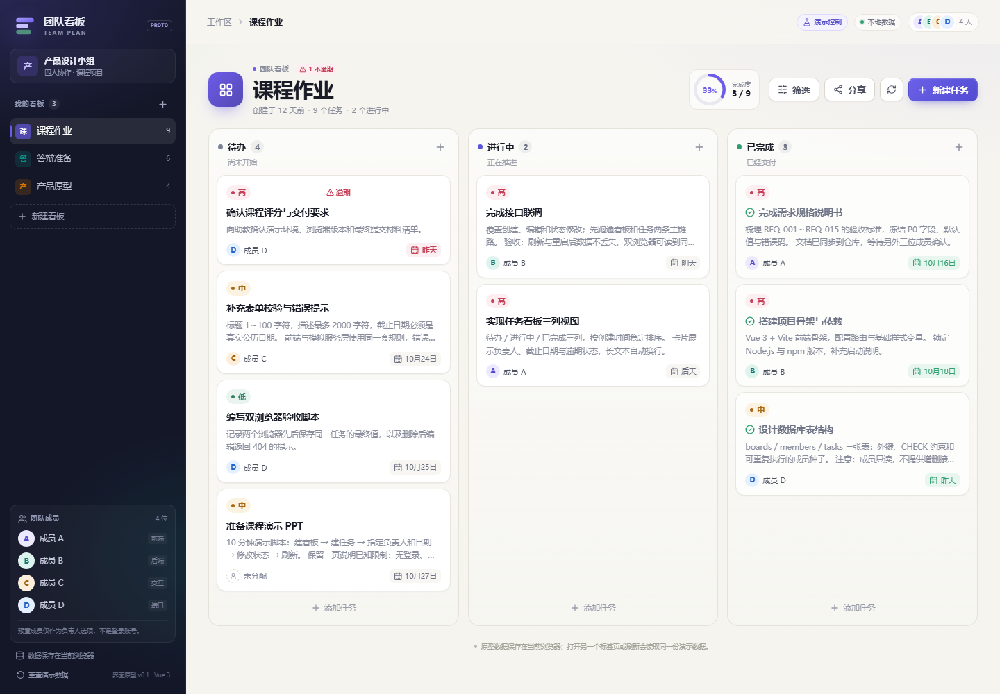

# 团队任务协作看板

“AI生成式软件”课程的四人协作项目，目标是实现轻量版 Trello：通过多个看板管理任务，展示负责人、截止日期和完成状态。

开发中可以使用 AI 辅助编写代码、测试和文档，组员按模块分工，负责理解、修改和验证结果。

**当前阶段：M1 项目骨架。** 仓库包含文档、原型素材、TASK-002 后端骨架与 TASK-005 数据库初始化/迁移（P0 表、固定成员种子、校验和与隔离测试），业务 API 与前端尚未实现；CHECK-001～043 尚未按清单执行。P0 契约已按 [spec.md](spec.md) v0.4 与 [architecture.md](architecture.md) v0.5 第 14 节冻结，并于 2026-10-21 经四人逐条确认（TASK-001 完成）；技术栈和部分业务细节仍需在 M1 结合课程要求确认。

## 预期效果



原型的看板主界面，作为实现后的视觉与交互参考；完整截图见 [prototype/screenshots](prototype/screenshots/)，界面风格参考 [global.css](prototype/styles/global.css)。

## 文档导航

| 文档 | 内容 | 使用场景 |
| --- | --- | --- |
| [spec.md](spec.md) | 功能规格、业务规则、页面、架构、数据库、API 契约、设计假设与风险 | 开发前明确范围、字段和验收条件 |
| [architecture.md](architecture.md) | 系统结构、模块接口、数据流、事务、部署方式，以及 M1 冻结决议与评审处理记录 | 理解技术方案、模块关系与已冻结边界 |
| [tasks.md](tasks.md) | M1～M5 实现计划、四人分工、依赖、任务状态和协作规范 | 领取任务、并行开发、接口联调和 PR 评审 |
| [checklist.md](checklist.md) | 核心与选做功能的可复现验证步骤 | 模块自测、集成验收和最终演示 |
https://hypersmart.feishu.cn/wiki/IK4YwAvp6i3X9hk5Ih1csuTjn9g

建议阅读顺序：功能规格 → 系统架构 → 实现计划 → 验证清单。文档通过 `REQ`、`TASK`、`CHECK` 编号关联。

## 功能范围

| 优先级 | 计划内容 |
| --- | --- |
| P0：必做 | 创建、查看和切换看板；任务创建、查看、编辑、删除；维护标题、描述、截止日期、负责人和状态；状态修改；持久化、输入校验、错误恢复及本地演示 |
| P1：核心完成后增加 | 任务优先级；按负责人、截止日期和优先级筛选；跨列拖拽及同列排序 |
| P2：时间允许再实施 | 可撤销的只读分享链接，以及保证只读所需的维护密钥访问控制 |

任务状态统一为：`todo`（待办）、`doing`（进行中）、`done`（已完成），允许任意双向流转。

核心版使用数据库预置的成员 A、B、C、D，负责人和截止日期允许为空。多个浏览器可以访问同一后端，通过人工刷新读取其他浏览器的修改；完整编辑采用后提交的成功更新覆盖先前更新，不自动合并冲突。

成员管理、用户登录、按用户授权和实时同步不在核心范围内。P1 筛选依赖优先级字段；拖拽可以独立选择。P2 分享须连同维护密钥保护一起实施，可以不选择任何 P1 功能。

## 建议技术方案

| 层次 | 建议技术 | 选择理由 |
| --- | --- | --- |
| 前端 | Vue 3 + TypeScript + Vite | 适合表单、组件分工和本地开发，类型有助于保持接口一致 |
| 后端 | Node.js + Express | API 层简洁，便于学生团队理解和联调 |
| 数据库 | SQLite | 无需单独安装数据库服务，便于本地运行、备份和演示 |

采用浏览器 → 同源 JSON API → 后端业务服务 → SQLite 的单实例结构，不引入额外云服务、缓存或消息队列。主要限制是并发写入能力、全量编辑可能覆盖他人修改，以及没有实时同步；详细边界见 [功能规格](spec.md)。

当前已可运行 TASK-002 的后端骨架与 TASK-005 的数据库初始化/迁移；业务 API 与前端尚未实现，运行步骤见下节。

## 本地运行（后端）

TASK-002 验证环境：Windows + Node.js 18.17.1 + npm 9.6.7；文档基线为 Node 22 LTS，课程机复核后再更新 `engines`。依赖通过 `package-lock.json` 锁定。

```powershell
npm install
Copy-Item .env.example .env
npm run db:init            # 建库、应用迁移 0001、写入四名固定成员；可重复执行
npm run dev:backend
```

- 健康检查：`curl http://127.0.0.1:3000/api/v1/health`
- 常用命令：`npm run typecheck`、`npm run test:backend`、`npm run build:backend`、`npm start -w backend`
- `npm run db:init` 可重复执行：只补待应用迁移和固定成员，不会删除已有看板或任务；数据库未初始化时服务启动失败。
- 启动失败以退出码 1 结束，不创建空库、不回退内存库；配置键见 `.env.example` 与 [architecture.md](architecture.md) 第 14 节。

## 四人分工

| 成员 | 主要开发责任 |
| --- | --- |
| 成员 A | 看板导航、任务三列展示、刷新与请求竞态；选做拖拽和分享 UI |
| 成员 B | 后端骨架、数据库、看板 API、本地部署；选做优先级/筛选后端和维护密钥保护 |
| 成员 C | 前端骨架、任务表单、状态/删除/日期与界面适配；选做优先级和筛选 UI |
| 成员 D | 统一 API 客户端、成员与任务 API；选做排序和分享后端 |

每个人同时负责自己模块的测试和缺陷修复。数据库和迁移由 B 主维护，API 契约文档由 A 主维护、D 技术核对；共享文件和具体依赖见 [实现计划](tasks.md)。

## 开发节奏与验收

1. **M1：范围和接口约定、项目骨架。** 确认设计假设，冻结字段、默认值和错误格式；TASK-001 已于 2026-10-21 完成四人确认，当前进入骨架与数据库开发。
2. **M2：必做功能闭环。** 接通真实前后端和数据库，尽早联调建板、建任务、展示和刷新。
3. **M3：联调与核心验收。** 覆盖持久化、看板隔离、错误恢复、双浏览器与界面适配。
4. **M4：选做功能。** 仅在核心门禁通过后按剩余时间选择，可以跳过。
5. **M5：最终验证与演示交付。** 在干净环境复演启动和完整业务流程，固定交付版本。

本计划不设工时或日历工期，进度按任务完成标准、前置依赖和里程碑门禁判断；M3 前不进入选做，M5 对最终版本复演。

核心完成要求：REQ-001～REQ-015 实现，对应任务完成，CHECK-001～CHECK-043 实测通过且有证据，覆盖 v0.4 新增的 Host 校验、安全响应头、健康失败 UI、迁移校验和与备份恢复断言，无阻断核心流程的缺陷。最终交付还需检查干净环境启动、演示和范围一致性；选做单独验收，未实施条目保持未勾选。

## 协作与提交规范

- `main` 保持可启动；每个任务使用短分支，通过 PR 评审后合并。
- PR 关联 TASK/REQ，说明行为变化、测试结果及接口/迁移影响，至少由一名非作者评审。
- 接口变更同步更新规格、类型、实现和验证项；数据库使用新迁移，由维护人顺序审核合并。
- 不提交本地 `.env`、数据库、密钥或真实个人信息；实际开发时补齐对应忽略规则。

Git 提交标题统一使用 `类型: 中文说明`，类型小写，英文冒号后空一格。例如：

```text
feat: 实现看板创建与切换
fix: 修复切换看板后任务列表显示错误
docs: 补充本地启动和数据库初始化说明
test: 补充任务状态流转测试
refactor: 提取任务表单校验逻辑
chore: 配置前后端开发代理
```

一次提交围绕一个明确改动；squash 合并后的最终提交标题也遵循该格式。完整约定见 [tasks.md](tasks.md)。

## 获取文档

```sh
git clone https://github.com/233zsq/team-plan.git
cd team-plan
```

使用编辑器或 GitHub 页面查看 Markdown 文档即可，目前无需安装应用依赖。

## 待确认事项

课程是否限制技术栈和部署环境；负责人及截止日期是否必填；是否另有成员管理、登录或实时同步要求；选做评分、截止日期及各成员投入时间。当前按 [spec.md](spec.md) v0.4 的设计假设推进；`Q-01`～`Q-11`（含驱动验证、CI、单仓结构、备份与重置）见 [architecture.md](architecture.md) 第 14.5 节，新增范围需先修订文档和计划。
